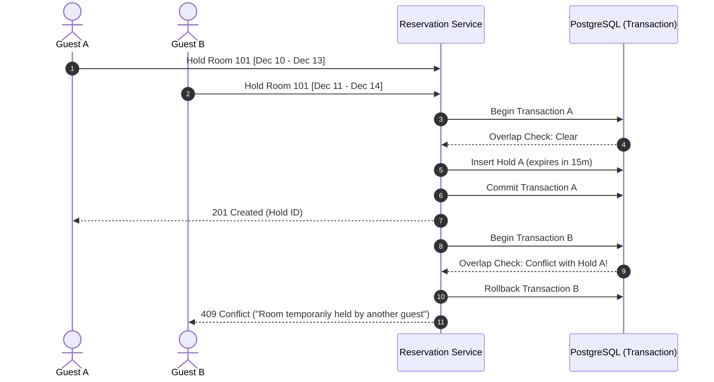
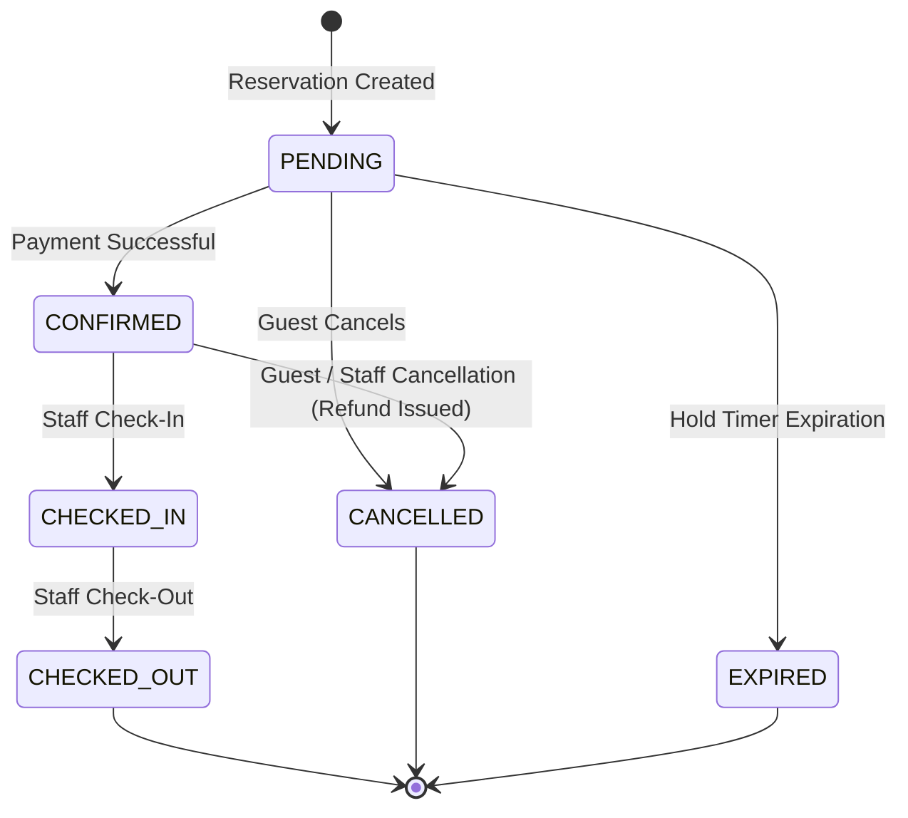

# System Architecture & Technical Specifications

This document outlines the architectural patterns, security controls, concurrency mechanisms, and data flows implemented in the **Hotel Booking Management System**.

---

## 1. Architectural Philosophy: The Modular Monolith

Rather than introducing distributed microservices with high operational overhead and network latency, the application is architected as a **cohesive, modular monolith** with strict boundaries between Presentation, API Routing, Business Logic, and Persistence.

```
┌─────────────────────────────────────────────────────────────┐
│                 Client Layer (React + Vite)                 │
│      Public Portal  │  Guest Dashboard  │  Staff & Admin    │
└──────────────────────────────┬──────────────────────────────┘
                               │  HTTPS / JSON / JWT Cookie
┌──────────────────────────────▼──────────────────────────────┐
│                  Express.js Application Core                │
│  ┌───────────────────────┐       ┌───────────────────────┐  │
│  │ Security Middlewares  │       │  Central Error Handler│  │
│  │ (Helmet, CORS, Rate)  │       │  & Swagger /api-docs  │  │
│  └───────────┬───────────┘       └───────────────────────┘  │
│              ▼                                              │
│  ┌───────────────────────────────────────────────────────┐  │
│  │     Role-Based Access Control (RBAC) & Zod Validation │  │
│  └───────────────────────────┬───────────────────────────┘  │
│                              ▼                              │
│  ┌───────────────────────────────────────────────────────┐  │
│  │                     Domain Services                   │  │
│  │  Auth  │  Availability  │  Reservation  │  Payment   │  │
│  │  Staff │  Admin Reports │  Inventory    │  Audit     │  │
│  └───────────────────────────┬───────────────────────────┘  │
└──────────────────────────────┼──────────────────────────────┘
                               │  Prisma ORM Client
┌──────────────────────────────▼──────────────────────────────┐
│                 PostgreSQL Persistence Layer                │
│    Relational Tables  │  Transactions  │  Composite Indexes │
└─────────────────────────────────────────────────────────────┘
```

### Layered Separation of Concerns
1. **Presentation (Client):** Responsive Single Page Application (SPA) built with React 19, TypeScript, and Tailwind CSS. State is managed via React Context with token persistence in LocalStorage and automatic cookie propagation.
2. **Gateway & Routing:** Express routers map REST endpoints to controller methods with pre-execution validation via Zod schemas and security rate limiters.
3. **Domain Services:** Encapsulate business logic, invariant enforcement, state machine validation, and transactional atomicity. Controllers remain lightweight delegators.
4. **Persistence (Prisma ORM + PostgreSQL):** Type-safe query engine interacting with normalized tables, transactional rollback, and composite B-tree indexes.

---

## 2. Concurrency Control & Double-Booking Prevention

Preventing overlapping reservations for the same room under simultaneous traffic is the most critical requirement of the system.

### A. The Half-Open Date Interval Condition
Hotel bookings follow the standard hospitality convention: **check-out occurs in the morning, and check-in occurs in the afternoon**. Therefore, two bookings for the same room do **not** conflict if one booking starts on the same day the previous booking ends.

Mathematically, the requested interval $[R_{\text{start}}, R_{\text{end}})$ overlaps with an existing interval $[E_{\text{start}}, E_{\text{end}})$ if and only if:
$$\text{Existing.checkInDate} < \text{Requested.checkOutDate} \quad \text{AND} \quad \text{Existing.checkOutDate} > \text{Requested.checkInDate}$$

### B. Two-Phase Locking with Database Transactions
To eliminate race conditions between concurrent requests:
1. **Step 1: Automatic Stale Hold Pruning:**
   Any existing holds where `expiresAt < NOW()` are transitioned to `EXPIRED` within the transaction before availability is queried.
2. **Step 2: Conflict Detection:**
   Inside an atomic `prisma.$transaction`, the database is queried for any conflicting reservation (`status IN ('CONFIRMED', 'CHECKED_IN')`) or active hold (`status = 'ACTIVE' AND expiresAt > NOW()`).
3. **Step 3: Atomic Hold / Reservation Creation:**
   If no conflict exists, the hold or reservation is committed. If a conflict is discovered, a `ConflictError (HTTP 409)` is thrown immediately, rolling back all queries.



---

## 3. Reservation Lifecycle & State Machine

Reservations strictly follow valid deterministic state transitions enforced in `server/src/services/reservation.service.ts`:



### Transition Enforcement Rules
- Checking in requires the reservation to be `CONFIRMED`.
- Checking out requires the reservation to be `CHECKED_IN`.
- Checking out an already completed stay (`CHECKED_OUT`) is strictly rejected with `400 Bad Request`.
- Cancelling a `CONFIRMED` reservation automatically updates all associated `SUCCESS` payments to `REFUNDED` status and immediately frees the room date range.

---

## 4. Role-Based Access Control (RBAC) Architecture

Three distinct roles are enforced on both client and server:

| Capability | Guest | Staff | Admin |
|---|:---:|:---:|:---:|
| Search Room Availability & Pricing | Yes | Yes | Yes |
| Place Holds & Book Rooms | Yes | Yes | Yes |
| View Personal Booking History & Receipts | Yes | Yes | Yes |
| Cancel Own Reservation & Receive Refund | Yes | Yes | Yes |
| View All Hotel Reservations | No | Yes | Yes |
| Today's Arrivals & Departures Desk | No | Yes | Yes |
| Check Guests In & Out | No | Yes | Yes |
| Toggle Room Status (Housekeeping / Maintenance) | No | Yes | Yes |
| Executive Analytics & Recharts Reports | No | No | Yes |
| Create / Delete Rooms & Room Categories | No | No | Yes |
| Manage User Roles (Promote / Demote) | No | No | Yes |
| View System Security Audit Trail | No | No | Yes |

### Security Measures
- **Password Protection:** Scrypt/Bcrypt hashing with cost factor 12.
- **Token Security:** Signed JSON Web Tokens with configurable expiration (7 days). Tokens are sent both in HTTP-only `SameSite=Lax` cookies (preventing client-side script theft) and Bearer headers for API clients.
- **Server-Side Enforcement:** Route-level middleware (`authenticate`, `authorize('STAFF', 'ADMIN')`) validates user claims on every request. Frontend button hiding is strictly cosmetic.
- **Rate Limiting:** Auth endpoints (`/api/auth/login`, `/api/auth/register`) are throttled by `express-rate-limit` to 20 requests per 15-minute window to prevent brute-force attacks.
