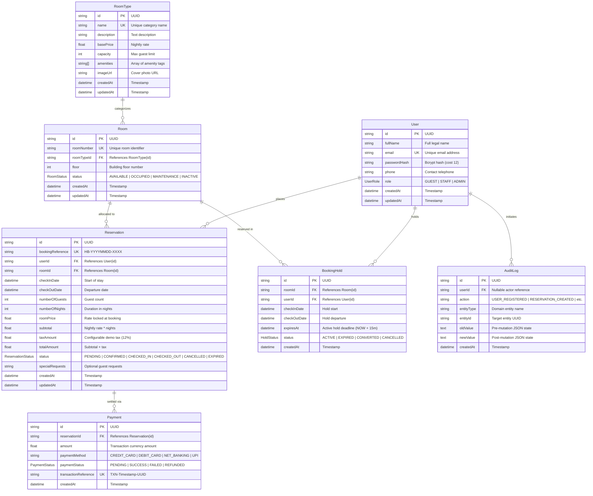

# Entity Relationship (ER) Diagram

This document illustrates the normalized relational database schema designed for the Hotel Booking Management System using PostgreSQL and Prisma ORM.

## Mermaid ER Diagram

---

## Schema Indices and Performance Optimizations

| Table | Index Columns | Index Purpose |
|---|---|---|
| `User` | `email` | Fast O(1) user lookup during login authentication |
| `User` | `role` | Filtered directory queries for staff/admin management |
| `RoomType` | `name` | Quick category lookups and unique constraint enforcement |
| `Room` | `roomNumber` | Direct room identity verification |
| `Room` | `roomTypeId` | Fast join query when loading rooms by category |
| `Room` | `status` | Rapid filtering of available rooms in the search engine |
| `Reservation` | `bookingReference` | O(1) human-readable reference resolution on arrival |
| `Reservation` | `userId` | Immediate listing of guest personal booking history |
| `Reservation` | `roomId` | Join index for room reservation lookups |
| `Reservation` | `status` | Operational queries (all CONFIRMED or CHECKED_IN stays) |
| `Reservation` | `checkInDate`, `checkOutDate` | B-tree index for date-range overlap scans |
| `Reservation` | `[roomId, checkInDate, checkOutDate]` | **Composite Index:** Eliminates table scans during critical double-booking concurrency checks |
| `Payment` | `reservationId` | Fast payment ledger retrieval for receipts and refunds |
| `Payment` | `paymentStatus` | Financial aggregations and dashboard revenue calculation |
| `BookingHold` | `expiresAt` | Quick cleanup of stale holds during background queries |
| `AuditLog` | `createdAt`, `action`, `entityType` | Filtered audit history retrieval by time and action |
